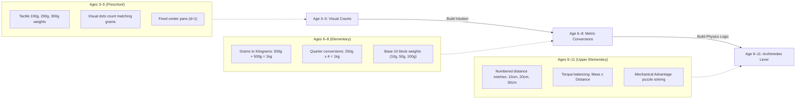

# Balance Scale: Grounded Math, Metric Conversions & i18n Specification

> **Implementation Status (2026-11-13)**: ✅ **Implemented** (with ⚠️ minor notation differences)  
> - **Implemented (✅)**: Equal-arm metric weight addition/decomposition (`3-5`, `6-8`), Archimedes lever torque balancing $\tau = m \times d$ (`9-11`), non-mirroring inventory generation, and English/French (`en`/`fr`) localization in [games/balance-scale/](file:///home/simo/Documents/www/kid-lesson-games/games/balance-scale/index.ts).  
> - **Discrepancies vs. Spec (⚠️)**: The implementation uses dimensionless integer notch multipliers (`1, 2, 3, 4`) rather than `10cm, 20cm, 30cm` labels, uses procedural solid color weight blocks rather than dot-count icons for `3-5`, and uses dynamic formatter functions (`formatStandardInstruction`, `formatLeverInstruction`) in `games/balance-scale/i18n.ts` instead of static `targetGram`/`targetKg` keys.

> **Educational Core**: Archimedes Law of the Lever + Metric Unit Conversions  
> **Defaults**: Metric (grams `g`, kilograms `kg`, centimeters `cm`, meters `m`), EU locale standards.

---

## 1. Grounded Physics: The Law of the Lever

```text
              d_L (cm)                                  d_R (cm)
      |<-------------------->|                  |<-------------------->|
    [ m_L ] (g)                                                      [ m_R ] (g)
    ---+---------------------+------------------+---------------------+---
                             |        /\        |
                             |       /  \ (Pivot)
```

The scale is in rotational equilibrium (perfect balance) when the net torque about the fulcrum is zero:

$$\sum \tau_{\text{Left}} = \sum \tau_{\text{Right}}$$

$$\sum (m_{L, i} \times d_{L, i}) = \sum (m_{R, i} \times d_{R, i})$$

### Why this is mathematically grounded for youngsters:
1. **Equal Distance ($d_L = d_R$)**:
   The distance cancels out $\implies m_L = m_R$. This teaches **pure addition & unit conversions** ($500\text{g} + 500\text{g} = 1\text{kg}$).
2. **Variable Distance ($d_L \neq d_R$)**:
   Teaches **multiplication and spatial intuition** ($200\text{g} \times 30\text{cm} = 600\text{g} \times 10\text{cm} = 6000\text{g}\cdot\text{cm}$).

---

## 2. Age Bracket Pedagogical Progression



---

## 3. Multilingual System (i18n)

Built-in dictionary supporting `en` (English) and `fr` (French):

| Key | English (`en`) | French (`fr`) |
| :--- | :--- | :--- |
| `title` | Balance Lab | Labo d'Équilibre |
| `level` | Level | Niveau |
| `score` | Score | Score |
| `reset` | Reset | Réinitialiser |
| `yourWeights` | Your Weights | Vos Poids |
| `targetGram` | Balance {val}g | Équilibrez {val}g |
| `targetKg` | Balance {val}kg ({grams}g) | Équilibrez {val}kg ({grams}g) |
| `leverTip` | Move weights along notches (cm) | Placez les poids sur les crans (cm) |
| `wellDone` | Perfect Balance! | Parfaitement Équilibré ! |
| `summary` | Mastered balance & metric conversions! | Maîtrise de l'équilibre et des conversions ! |

---

## 4. Metric Unit Conversions Breakdown

```text
 1 kg  =  1 000 g
 0.5 kg =   500 g  (1/2 kg)
0.25 kg =   250 g  (1/4 kg)
 0.1 kg =   100 g  (1/10 kg)
```
Visual weights show both the primary unit (e.g. `1 kg`) and secondary hint (e.g. `1000g`) depending on age level settings.
