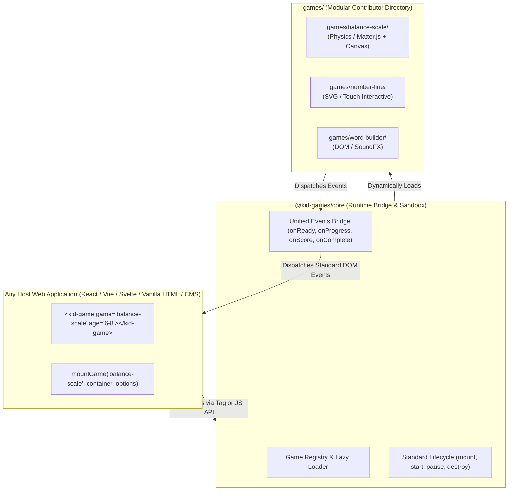
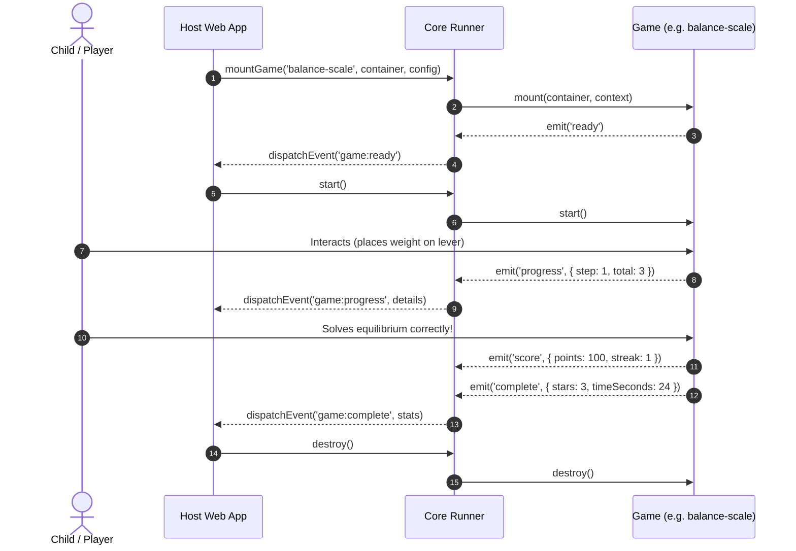

# Pluggable Game Contract Specification

> **Status**: Draft Proposal  
> **Target**: Contributor-friendly pluggable web games for youngsters (Numbers, Letters, Logic, Spatial)

---

## 1. High-Level Architecture



---

## 2. The Contributor Directory Structure

Adding a new game should be a zero-friction process: clone the repository, drop a folder into `games/<game-id>`, fill in metadata and implement the lifecycle methods.

```text
games/
  └── balance-scale/
       ├── game.json         # Metadata: age group, skills, difficulty, description
       ├── index.ts          # Game entry point fulfilling the KidGame interface
       ├── assets/           # Local sounds, sprites, SVGs, textures
       └── README.md         # Educational purpose, pedagogy notes, mechanics
```

---

## 3. Metadata Contract (`game.json`)

Enables the host application and game picker to display cards, filter by age bracket, and search by skill without loading heavy game scripts upfront:

```json
{
  "id": "balance-scale",
  "title": "Balance the Scale",
  "version": "1.0.0",
  "description": "Place weights on the beam to find equilibrium using lever physics!",
  "author": "Contributor Name",
  "category": "numbers",
  "ageGroups": ["6-8", "9-11"],
  "skills": ["addition", "lever-physics", "spatial-estimation", "balance"],
  "thumbnail": "assets/thumb.svg",
  "defaultConfig": {
    "sound": true,
    "difficulty": "medium",
    "theme": "playful"
  }
}
```

### Age Bracket Glossary (*Tranches d'âge*)
- `3-5`: Preschool / Early Explorers (tactile, visual, shape & count recognition)
- `6-8`: Early Elementary (single-digit math, intuitive balance, letter sounds)
- `9-11`: Upper Elementary (multiplication, lever distance physics, fractions)

---

## 4. Runtime Interface Contract (`KidGame`)

Every game exports a factory or class that conforms to the `KidGame` lifecycle:

```typescript
export interface GameContext {
  ageGroup: '3-5' | '6-8' | '9-11';
  sound: boolean;
  difficulty?: 'easy' | 'medium' | 'hard';
  assetsBaseUrl?: string;
  onEvent?: (event: GameEvent) => void;
}

export interface GameEvent {
  type: 'ready' | 'progress' | 'score' | 'complete' | 'error';
  payload: Record<string, unknown>;
}

export interface KidGame {
  /**
   * 1. Mount: Attaches canvas/DOM elements to container, preloads assets.
   */
  mount(container: HTMLElement, context: GameContext): Promise<void> | void;

  /**
   * 2. Start: Launches gameplay loop, timers, user interaction.
   */
  start(): void;

  /**
   * 3. Pause / Resume: Optional handlers for when tab loses focus or host app pauses.
   */
  pause?(): void;
  resume?(): void;

  /**
   * 4. Teardown: MANDATORY. Must remove DOM nodes, disconnect resize observers,
   * cancel animation frames, stop audio contexts, and clear physics engines.
   * Zero memory leaks contract.
   */
  destroy(): void;
}
```

---

## 5. Standard Event Protocol

The host app and game communicate through standard events:



---

## 6. Host Integration Methods

### Method A: Web Component (Universal Custom Element)
```html
<script type="module" src="/dist/kid-games.js"></script>

<!-- Clean, declarative tag -->
<kid-game 
  game="balance-scale" 
  age="6-8" 
  sound="true">
</kid-game>

<script>
  const el = document.querySelector('kid-game');
  el.addEventListener('game:complete', (event) => {
    console.log('Game finished! Stats:', event.detail);
  });
</script>
```

### Method B: Programmatic JS Factory
```javascript
import { mountGame } from '@kid-games/core';

const game = await mountGame('balance-scale', document.getElementById('game-slot'), {
  ageGroup: '6-8',
  sound: true,
  onEvent: (event) => {
    if (event.type === 'complete') {
      celebrate(event.payload.stars);
    }
  }
});

// When user navigates away or switches games:
game.destroy();
```

---

## 7. Contributor Guardrails & Best Practices

1. **No Reinventing the Wheel**:
   - Use safe, well-maintained libraries (e.g., Matter.js for physics, Howler or Web Audio API for sound effects, Canvas / SVG for visuals).
2. **Container Agnostic**:
   - The game must adapt responsively to its parent container's dimensions via `ResizeObserver`.
3. **Strict Teardown**:
   - `destroy()` must be 100% clean so multiple games can mount/unmount in Single Page Applications without memory bloat.
