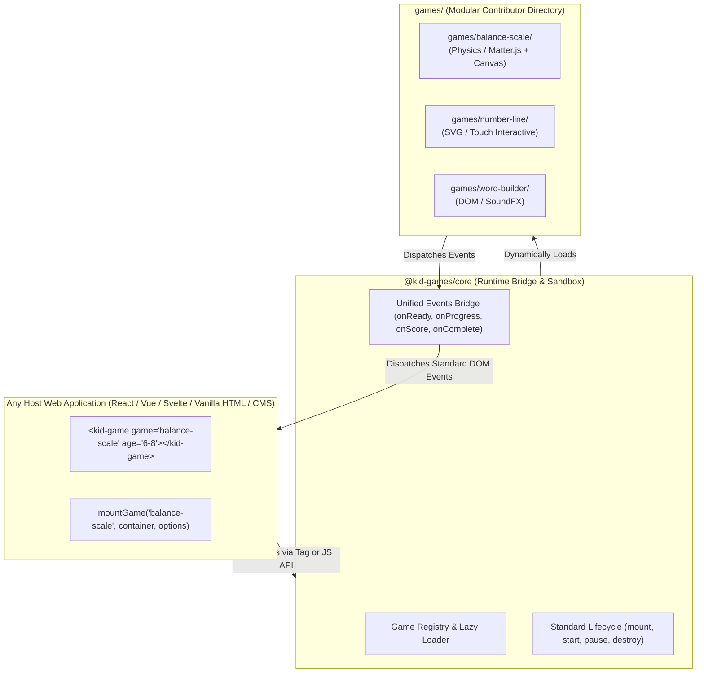
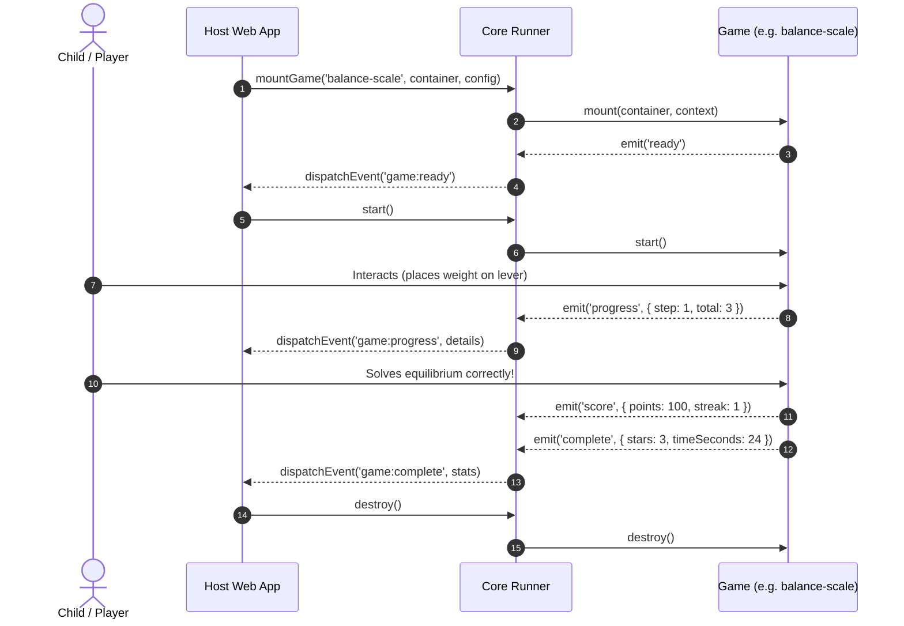

# Pluggable Game Contract Specification

> **Implementation Status (2026-11-13)**: 🚧 **Partial** (Core `KidGame` contract, `GameContext`, `SoundEngine`, `I18nManager`, and lazy `import.meta.glob` loader are ✅ **Implemented**; standalone `mountGame()` helper and `defaultConfig` in `game.json` are 🗺️ **Planned**)  
> - **Implemented (✅)**: `KidGame` lifecycle (`mount`, `start`, `pause`, `resume`, `updateConfig`, `destroy`), `GameContext` with injected `SoundEngine` (`context.audio`), `I18nManager` (`context.i18n`, `context.t`), `context.emit`, eager `game.json` / `meta.json` catalog discovery, lazy per-cartridge ES chunking, and `currentLoadToken` race-condition protection in [src/](file:///home/simo/Documents/www/kid-lesson-games/src/index.ts).  
> - **Not Implemented / Planned (🗺️)**: Programmatic `mountGame('balance-scale', container, options)` factory from `@kid-games/core` (use `<kid-game>` or `registry.create(id)` today), and `defaultConfig` in `game.json`.  
> - **Discrepancies vs. Spec (⚠️)**: Package name in `package.json` is `kid-lesson-games` (not `@kid-games/core`); bundle filename is `dist/kid-games.es.js` (not `/dist/kid-games.js`); and all 6 cartridges implement custom deterministic TypeScript/Canvas 2D physics rather than importing `matter-js` or external audio/sprite files in `assets/`.

> **Status**: Draft Proposal  
> **Target**: Contributor-friendly pluggable web games for youngsters (Numbers, Letters, Logic, Spatial)

---

## 1. High-Level Architecture



---

## 2. The Contributor Directory Structure

Adding a new game should be a zero-friction process: clone the repository, drop a folder into `games/<game-id>`, fill in metadata and implement the lifecycle methods.

```text
games/
  └── balance-scale/
       ├── game.json         # Metadata: age group, skills, difficulty, description
       ├── index.ts          # Game entry point fulfilling the KidGame interface
       ├── assets/           # Local sounds, sprites, SVGs, textures
       └── README.md         # Educational purpose, pedagogy notes, mechanics
```

---

## 3. Metadata Contract (`game.json`)

Enables the host application and game picker to display cards, filter by age bracket, and search by skill without loading heavy game scripts upfront:

```json
{
  "id": "balance-scale",
  "title": "Balance the Scale",
  "version": "1.0.0",
  "description": "Place weights on the beam to find equilibrium using lever physics!",
  "author": "Contributor Name",
  "category": "numbers",
  "ageGroups": ["6-8", "9-11"],
  "skills": ["addition", "lever-physics", "spatial-estimation", "balance"],
  "thumbnail": "assets/thumb.svg",
  "defaultConfig": {
    "sound": true,
    "difficulty": "medium",
    "theme": "playful"
  }
}
```

### Age Bracket Glossary (*Tranches d'âge*)
- `3-5`: Preschool / Early Explorers (tactile, visual, shape & count recognition)
- `6-8`: Early Elementary (single-digit math, intuitive balance, letter sounds)
- `9-11`: Upper Elementary (multiplication, lever distance physics, fractions)

---

## 4. Runtime Interface Contract (`KidGame`)

Every game exports a factory or class that conforms to the `KidGame` lifecycle:

```typescript
import type { SoundEngine } from '../src/core/audio.js';
import type { I18nManager } from '../src/core/i18n.js';

export interface GameContext {
  ageGroup: '3-5' | '6-8' | '9-11';
  difficulty: 'easy' | 'medium' | 'hard';
  sound: boolean;
  locale: string;
  customLevels?: unknown;
  audio: SoundEngine;
  i18n: I18nManager;
  t: (key: string, params?: Record<string, string | number>) => string;
  emit: <T extends GameEventType>(type: T, payload: GameEventPayloads[T]) => void;
}

export interface KidGame {
  /**
   * 1. Mount: Attaches canvas/DOM elements to container, preloads assets.
   */
  mount(container: HTMLElement, context: GameContext): Promise<void> | void;

  /**
   * 2. Start: Launches gameplay loop, timers, user interaction.
   */
  start(): void;

  /**
   * 3. Pause / Resume: Optional handlers for when tab loses focus or host app pauses.
   */
  pause?(): void;
  resume?(): void;

  /**
   * 4. Update Config: Dynamically updates options (locale, sound, difficulty) mid-game.
   */
  updateConfig?(newContext: Partial<GameContext>): void;

  /**
   * 5. Teardown: MANDATORY. Must remove DOM nodes, disconnect resize observers,
   * cancel animation frames, stop audio contexts, and clear physics engines.
   * Zero memory leaks contract.
   */
  destroy(): void;
}
```

---

## 5. Shared Core Utilities vs. Cartridge Isolation

To keep cartridge generation fast and maintainable across dozens of games, common procedural audio synthesis and localized resolution are managed by `<kid-game>` and injected via `GameContext`:

### A. Shared Procedural Audio (`context.audio`)
The core `SoundEngine` provides zero-asset procedural Web Audio SFX:
- `playPop()`: Bubble pop or item select (rising pitch sweep)
- `playDrop()` / `playThud()`: Impact, snap, or slotting
- `playClick()`: Crisp UI button tap
- `playChime()`: Milestone or intermediate solved chime
- `playSuccess()`: Multi-note celebratory fanfare
- `playError()`: Gentle low-buzz feedback
- `playTone(freq, duration, type, options)`: Arbitrary custom frequency synthesizer

The AudioContext lifecycle (auto-resuming suspended audio contexts upon first user interaction, muting, volume, and clean closure) is handled by the host element.

### B. Shared i18n & Cartridge Dictionaries (`context.i18n`)
- Core common tokens (`soundOn`, `soundOff`, `level`, `score`, `reset`, `wellDone`, `loading`, `error`) are available via `context.t(key)`.
- Cartridges define localized strings and bind them via `createI18nResolver(DICTIONARY, defaultLocale)` for type-safe cartridge translation lookup.

---

## 6. Dynamic Lazy Loading & Concurrency Guarantees

- **Lightweight Catalog Discovery**: All metadata files (`games/*/{game,meta}.json`) are loaded eagerly so `registry.list()` is synchronous and lightweight for host menus.
- **Dynamic Chunking**: Game modules (`games/*/index.ts`) are dynamically imported via lazy `import.meta.glob`. Vite code-splits each cartridge into an independent ES chunk (`dist/<game-id>-*.js`), keeping the initial shell bundle minimal.
- **Race Condition Prevention**: `<kid-game>` increments a monotonic `loadToken` sequence number on attribute changes. If the user rapidly switches games or unmounts the component mid-load, obsolete asynchronous imports and mounts are aborted immediately, preventing race condition DOM collisions and orphan background loops.

---

## 5. Standard Event Protocol

The host app and game communicate through standard events:



---

## 6. Host Integration Methods

### Method A: Web Component (Universal Custom Element)
```html
<script type="module" src="/dist/kid-games.js"></script>

<!-- Clean, declarative tag -->
<kid-game 
  game="balance-scale" 
  age="6-8" 
  sound="true">
</kid-game>

<script>
  const el = document.querySelector('kid-game');
  el.addEventListener('game:complete', (event) => {
    console.log('Game finished! Stats:', event.detail);
  });
</script>
```

### Method B: Programmatic JS Factory
```javascript
import { mountGame } from '@kid-games/core';

const game = await mountGame('balance-scale', document.getElementById('game-slot'), {
  ageGroup: '6-8',
  sound: true,
  onEvent: (event) => {
    if (event.type === 'complete') {
      celebrate(event.payload.stars);
    }
  }
});

// When user navigates away or switches games:
game.destroy();
```

---

## 7. Contributor Guardrails & Best Practices

1. **No Reinventing the Wheel**:
   - Use safe, well-maintained libraries (e.g., Matter.js for physics, Howler or Web Audio API for sound effects, Canvas / SVG for visuals).
2. **Container Agnostic**:
   - The game must adapt responsively to its parent container's dimensions via `ResizeObserver`.
3. **Strict Teardown**:
   - `destroy()` must be 100% clean so multiple games can mount/unmount in Single Page Applications without memory bloat.
