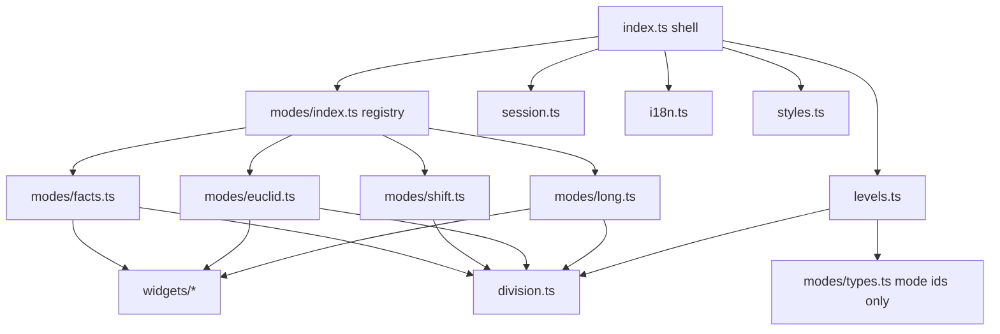
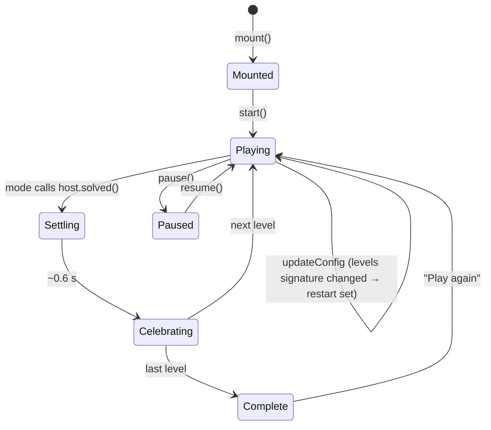

# 03 — Architecture

> Part of the [`number-workshop` plan](README.md). Status: 🗺️ Planned.
> Facts marked ✅ were checked against the code on 2026-11-14 (`src/index.ts`, `src/core/KidGameElement.ts`, `src/core/i18n.ts`, `index.html`, `tsconfig.json`, `vitest.config.ts`).

## 1. File layout (final state, after all work packages)

```text
games/number-workshop/
├── game.json               # id, title, version, category "numbers", ageGroups, skills, thumbnail
├── assets/thumb.svg
├── README.md
├── levels.schema.json      # LLM-facing JSON Schema (02-level-schema.md §6)
│
├── division.ts             # pure maths
├── levels.ts               # Level types, LIMITS, parseCustomLevels, generateLevelsForAge, levelsSignature
├── session.ts              # pure session state: level index, score, mistakes, stars, timing
├── i18n.ts                 # EN + FR dictionary (createI18nResolver) and number formatting
├── styles.ts               # the cartridge's CSS as one string constant
│
├── index.ts                # NumberWorkshopGame: HUD shell, level flow, lifecycle; createGame()
├── modes/
│   ├── types.ts            # ModeController, ModeHost interfaces
│   ├── index.ts            # MODE_REGISTRY: the one list of built modes
│   ├── facts.ts
│   ├── shift.ts
│   ├── euclid.ts
│   └── long.ts
├── widgets/
│   ├── drag.ts             # tap-or-drag helper (threshold, snap radius, cleanup)
│   ├── group-builder.ts    # shared by facts (Array tier) and euclid
│   └── keypad.ts           # 0–9 keypad with backspace
│
└── *.test.ts               # one test file next to each module (05-test-plan.md)
```

Why several files when the other cartridges are single 2 000-line `index.ts` files: the pure/DOM split keeps the maths trivially testable, and one file per mode lets each mode be reviewed and delivered alone. Only `index.ts` is discovered by the core (`import.meta.glob('../games/*/index.ts')` matches one level deep ✅), so the extra files are invisible to `src/`.

`index.ts` re-exports `generateLevelsForAge` and `parseCustomLevels` so the cartridge satisfies the contribution contract (AGENTS.md §3.4) at the usual import path.

## 2. Dependency direction



Rules: `division.ts`, `levels.ts`, `session.ts` never touch the DOM. Modes never import each other or the shell. Nothing in the cartridge imports from another cartridge. From `src/` only **types** and `createI18nResolver` are imported, as the other cartridges do ✅.

`levels.ts` must know which modes are built without importing DOM code. So the list of built mode **ids** is a plain constant in `modes/types.ts` (`BUILT_MODES`), and `modes/index.ts` maps each id to its controller factory; a test asserts the two agree.

## 3. The mode plug-in contract

```ts
// modes/types.ts
export type ModeId = 'facts' | 'shift' | 'euclid' | 'long';
export const BUILT_MODES: readonly ModeId[] = [/* grows by one per mode PR */];

export interface ModeHost {
  readonly signal: AbortSignal;              // aborted when the level or the game is torn down
  readonly difficulty: Difficulty;
  readonly reducedMotion: boolean;
  t(): Dictionary;                           // current locale's strings
  formatNumber(n: number): string;
  audio: SoundEngine;                        // context.audio; never closed by the cartridge
  setInstruction(text: string): void;        // live HUD text (textContent)
  setTimeout(fn: () => void, ms: number): void; // tracked; cleared on teardown and frozen on pause
  reportMistake(): void;
  solved(): void;                            // call once; the shell runs settle → celebrate → advance
}

export interface ModeController {
  mount(stage: HTMLElement, level: Level, host: ModeHost): void;
  onLocaleChange(): void;                    // re-render text in place, keep the child's progress
  setPaused(paused: boolean): void;
  reset(): void;                             // HUD reset button: restart this level
  destroy(): void;                           // remove own DOM; listeners die with host.signal
}
```

The shell owns everything shared: HUD, level badge, score, sound toggle, reset, banner, confetti, telemetry, timers, the end screen. A mode owns only its stage and decides when the level is solved. A mode never calls `context.emit` and never advances the level itself.

## 4. Shell flow



Level set selection, at `mount` and whenever the signature changes: `parseCustomLevels(context.customLevels) ?? generateLevelsForAge(ageGroup, difficulty)`.

## 5. Telemetry, score, stars

Only the existing typed events are used ✅ (`GameEventPayloads` in `src/core/types.ts`); no new event names.

| When | Event | Payload |
|---|---|---|
| A level is solved | `game:progress` | `{ step: <1-based index>, total: <levels>, detail: '<mode> <dividend>÷<divisor>' }` |
| Same moment | `game:score` | `{ points: <running total>, delta: <100 or 150>, streak: <consecutive clean levels> }` |
| Last level solved | `game:complete` (once) | `{ stars, score, timeElapsed, summary }` |

- Score: 100 per solved level, +50 if the level had no mistake.
- Stars: 3 if total mistakes ≤ 1; 2 if total mistakes ≤ number of levels; otherwise 1.
- `timeElapsed`: whole seconds of active play, excluding paused time.
- `detail` and `summary` are built from numbers and fixed words only.
- All of this lives in `session.ts` as pure functions so it is unit-tested without a DOM.
- A new age, difficulty, or level set is a new run: score, mistakes, streak, and timer restart (same convention as `pulley-lift` ✅).

## 6. Repo gotchas that shape the code (all ✅ verified)

### 6.1 The host resends the whole config on every attribute change
`KidGameElement.propagateConfigUpdate()` calls `updateConfig` with `ageGroup`, `difficulty`, `sound`, `locale`, `customLevels`, `audio`, `i18n`, `t` whenever **any** observed attribute changes, and `customLevels` is `null`, never `undefined`, when no levels are set. A sound toggle therefore arrives with `customLevels: null`.

Rule: in `updateConfig`, merge fields into `this.context` (never replace it: `emit` is not resent), then compute `levelsSignature` of the newly resolved set **only when age, difficulty, or the raw `customLevels` value changed**, and restart the set only if the custom signature differs from the current one. Toggling sound or locale must never reset the child's progress. This is a required test.

### 6.2 Never throw from `mount`, never put external data in an `Error`
An error thrown while mounting replaces the game with the host's error screen, and its message is displayed there. The cartridge must not throw during `mount`/`start`, and must never build an error message from `levels`, `locale`, or any other external value. Invalid input always degrades to procedural levels.

### 6.3 `locale` is an arbitrary string
`<kid-game locale>` is passed through unvalidated. `createI18nResolver` already falls back to `en` for unknown values, but `new Intl.NumberFormat('<bad>')` throws `RangeError`. Rule: reduce the locale to `'en' | 'fr'` first (same normalisation as the resolver: lower-case, split on `-`/`_`, default `en`) and only pass that to `Intl`.

### 6.4 The game lives inside a shadow root
The container is a `<div>` inside the host's open shadow root, so page CSS does not reach it. The cartridge injects its own `<style>` element (from `styles.ts`) into the container, as `pulley-lift` does. Queries use `this.container.querySelector`, never `document`.

### 6.5 jsdom is missing browser APIs
In the test environment `PointerEvent`, `Element.prototype.setPointerCapture`, `ResizeObserver`, and `window.matchMedia` are all `undefined`. Rule: feature-check each before use (`typeof … !== 'undefined'`, optional calls). Listen for `pointerdown`/`pointermove`/`pointerup` (one code path for mouse, touch, pen); tests dispatch `new MouseEvent('pointerdown', …)`. Every primary action must also work through a plain `click`, which is what keyboard and most tests use.

### 6.6 Static DOM only
`innerHTML` may be used only with string constants written in the source. Anything derived from levels, locale, or attributes goes through `textContent`, `createElement`, and `setAttribute` with fixed attribute names. Numbers are rendered via `formatNumber`, never interpolated into markup.

### 6.7 Zero-leak teardown
One game-level `AbortController` for HUD and window listeners; one per mounted level for mode listeners. All timers go through the shell's tracked `setTimeout`. `destroy()` aborts both controllers, clears timers, cancels any animation frame, disconnects any observer, empties the container, and does **not** call `context.audio.close()`.

### 6.8 Working directory
A fresh worktree has no `node_modules`; run `npm ci` once (it does not rewrite the lockfile). Use a free dev-server port if another agent is running one.

## 7. What is explicitly not in the cartridge

No `requestAnimationFrame` game loop (CSS transitions do the motion; a loop may be added by a mode only if it is paused, resumed, and cancelled correctly), no physics engine, no canvas, no network, no storage, no new npm dependency. `canvas-confetti` is already a dependency ✅ and is used for the celebration like the other cartridges.
