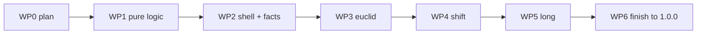

# 06 — Delivery Plan (Work Packages)

> Part of the [`number-workshop` plan](README.md). Status: 🗺️ Planned.
> One work package (WP) = one branch = one PR = one agent, delivered in order, each following AGENTS.md §0 Gates 1–10 including independent review. A WP starts only after the previous one is merged.

## Overview

| WP | Branch | Visible on the playground? | Cartridge status after merge | Library semver impact |
|---|---|---|---|---|
| 0 | `docs/number-workshop-plan` | no | 🗺️ | none (docs) |
| 1 | `feat/number-workshop-logic` | no (no `game.json`) | 🗺️ | patch (internal, not user-visible) |
| 2 | `feat/number-workshop-facts` | **yes**: `facts` playable for all ages | 🚧 `0.1.0` | minor (new game) |
| 3 | `feat/number-workshop-euclid` | yes | 🚧 `0.2.0` | minor |
| 4 | `feat/number-workshop-shift` | yes | 🚧 `0.3.0` | minor |
| 5 | `feat/number-workshop-long` | yes | 🚧 `0.4.0` | minor |
| 6 | `feat/number-workshop-finish` | yes | ✅ `1.0.0` | patch |

Version note: AGENTS.md says feature PRs never bump versions (multi-agent rule 4) and also that a cartridge change updates that cartridge's `game.json` version (Gate 6, Gate 9). This plan reads that as: the author sets the **cartridge** version shown above; the **library** version in `package.json` is touched only by the Merger. The owner confirmed this reading (Q7).

Rules common to every WP:

- Files listed under "Touches" are the claimed territory. Anything else needs the owner's OK first.
- Never touched by any WP: `src/**`, `package.json`, `package-lock.json`, `vite.config.ts`, `tsconfig.json`, `vitest.config.ts`, `.github/**`, other cartridges, `scripts/**`.
- `CHANGELOG.md`: one line under `[Unreleased]` per WP.
- Commits: tests and pure code, then UI, then docs, as separate Conventional Commits with scope `number-workshop`.
- The PR description pastes the Gate 5 output and the play-test results ([04-ux-and-vibe.md](04-ux-and-vibe.md) §9) for UI packages.
- **Size guard**: if a WP's non-test diff is heading past roughly 1 200 lines, stop and propose a split to the owner instead of pushing through.

---

## WP0 — This plan

**Done when**: the docs PR is reviewed and merged. The owner approved the plan and accepted every default for Q1–Q7 on 2026-11-14 ([README.md](README.md) §4).

---

## WP1 — Pure logic (invisible)

**Goal**: all maths, parsing, generation, and session scoring exist and are proven, with no game registered.

**Touches** (all new, under `games/number-workshop/`): `division.ts`, `levels.ts`, `session.ts`, `modes/types.ts` (only the `ModeId` type, `ALL_MODES`, and `BUILT_MODES = []`; the controller interfaces arrive in WP2 because they depend on `i18n.ts`), `levels.schema.json`, and `division.test.ts`, `levels.test.ts`, `session.test.ts`. Plus `CHANGELOG.md`.

**Must not add**: `game.json`, `index.ts` (decision D2). Do not run `npm run create-game` in this WP: it creates both.

**Notes**
- `parseCustomLevels(raw, modes = BUILT_MODES)` and `generateLevelsForAge(age, difficulty, rng, modes = BUILT_MODES)` take the enabled-mode list as a last optional parameter so tests can exercise all four modes while none is built. With an empty list the parser returns `null` and the generator returns `[]`; nothing calls them that way in WP1.
- Spec: [02-level-schema.md](02-level-schema.md); tests: [05-test-plan.md](05-test-plan.md) §3 (`division`, `levels`, `session`).

**Acceptance**
- [ ] Every golden value and every listed parser/generator case passes.
- [ ] `npm run build` output has no `number-workshop` chunk and the playground's game list is unchanged (still 6).
- [ ] No DOM access in any of the three modules (the test files run without touching `document`).
- [ ] Coverage of the three modules ≥ 95 % lines.

---

## WP2 — Shell + `facts` (first playable slice)

**Goal**: a complete, polished, honest game with one mode. This PR sets the quality bar and the visual language for everything after it.

**Touches** (cartridge): `game.json` (`0.1.0`, category `numbers`, all three age groups, skills `division`, `equal-sharing`), `assets/thumb.svg`, `index.ts`, `i18n.ts`, `styles.ts`, `modes/index.ts`, `modes/types.ts` (`BUILT_MODES = ['facts']`, plus the `ModeHost` and `ModeController` interfaces), `modes/facts.ts`, `widgets/drag.ts`, `widgets/group-builder.ts`, `README.md`, tests for each. Do **not** run `npm run create-game number-workshop`: the script refuses when the directory already exists, and WP1 created it. Write the files by hand, using `scripts/create-game.js` and an existing cartridge only as reading material for the lifecycle pattern.

**Touches** (shared, minimal): `index.html` (static `<option>` and a `customPresetsByGame` entry with a `facts`-only preset), root `README.md` (game table row labelled 🚧, counts), `docs/VISION.md` (catalogue row and gap table), `TODO.md`, `AGENTS.md` (cold-start "6 games" count and list), `CHANGELOG.md`.

**Notes**
- While only `facts` is built, ages `9-11` play `facts` levels in the Array tier with remainders; the cartridge README says clearly which modes exist and which are 🗺️.
- Choose and document the semantic colours ([04-ux-and-vibe.md](04-ux-and-vibe.md) §2) with their contrast ratios in the cartridge README.
- Implement every repo gotcha of [03-architecture.md](03-architecture.md) §6; each has a named test in [05-test-plan.md](05-test-plan.md).

**Acceptance**
- [ ] All three `facts` tiers are playable by mouse, touch, and keyboard; undo works; remainder levels explain the left-over.
- [ ] Ages 3–5 see no `÷` and no equation.
- [ ] Shell tests and `facts` tests pass; the custom preset in `index.html` round-trips through `parseCustomLevels`.
- [ ] Play-test script completed for all three ages; screenshots or a GIF in the PR.
- [ ] Docs say 🚧 with "1 of 4 modes", and every "6 games" count that is now wrong is fixed.

---

## WP3 — `euclid`

**Touches**: `modes/euclid.ts`, `widgets/keypad.ts`, tests for both, `modes/types.ts` + `modes/index.ts` (register), `i18n.ts`, `styles.ts`, `game.json` (`0.2.0`, add skill `euclidean-division`), cartridge `README.md`, `index.html` preset (add `euclid` levels), the cartridge's status row in root `README.md` and `docs/VISION.md` ("2 of 4 modes"), `CHANGELOG.md`.

**Acceptance**
- [ ] Reuses `group-builder` unchanged or with a backward-compatible extension (no fork).
- [ ] The three wrong paths (too far, false equality, true equality with `r ≥ b`) each give their own hint; test for each.
- [ ] Ages `6-8` at `medium`/`hard` now end with an `euclid` level; `9-11` sets include it.
- [ ] Play-test script for the mode; `facts` re-checked for regressions.

---

## WP4 — `shift`

**Touches**: `modes/shift.ts` + test, register, `i18n.ts`, `styles.ts`, `game.json` (`0.3.0`, add skill `place-value`), cartridge `README.md`, `index.html` preset, the status row in root `README.md` and `docs/VISION.md` ("3 of 4 modes"), `CHANGELOG.md`.

**Acceptance**
- [ ] Digit strip moves by drag and by button; a non-zero digit cannot leave the table.
- [ ] Over-shift and under-shift each fail Check with a hint that names the number of slides.
- [ ] Six-digit dividends (`789 000`) fit at 375 px width.
- [ ] Column labels in `en` and `fr` (⚠️ French abbreviations confirmed by the owner or flagged in the PR).

---

## WP5 — `long`

The largest mode; plan it as its own careful PR.

**Touches**: `modes/long.ts` + test, register, `i18n.ts`, `styles.ts`, `game.json` (`0.4.0`, add skill `long-division`), cartridge `README.md`, `index.html` preset, the status row in root `README.md` and `docs/VISION.md` ("4 of 4 modes, finishing"), `CHANGELOG.md`.

**Acceptance**
- [ ] Walks the computed trace step by step in the potence layout; the three difficulty levels differ exactly as in [01-pedagogy-and-modes.md](01-pedagogy-and-modes.md) §2.4.
- [ ] `568 ÷ 8` (first partial is two digits) and `816 ÷ 8` (zero digit) are both solvable and tested end to end.
- [ ] Ends with the equality step.
- [ ] Four-digit dividends fit at 375 px width and 400 px height.
- [ ] Too-big and too-small digit hints are correct for every step of the four golden traces.

---

## WP6 — Finish to 1.0.0

**Goal**: the cartridge meets every line of AGENTS.md §3 and §9 and is labelled ✅.

**Touches**: `game.json` (`1.0.0`, final description), cartridge `README.md` (full write-up: purpose, age progression, formulas, level schema, example), `index.html` (the full 25-level sheet preset of [05-test-plan.md](05-test-plan.md) §1, plus one short preset per mode), root `README.md`, `docs/VISION.md`, `TODO.md` (tick Theme 3 item and Theme 6 items that are now true), `docs/design/number-workshop/*` (status lines → ✅ with any ⚠️ deviations recorded, as the other design specs do), `CHANGELOG.md`.

**Acceptance**
- [ ] Full cross-mode play-test at every age × difficulty; a complete 9–11 session and the 25-level sheet preset played to the end.
- [ ] Coverage for the cartridge reported in the PR; no file under 80 % lines without a stated reason.
- [ ] Every status label and game count in the repo is true.
- [ ] Follow-ups discovered along the way are listed in `TODO.md` as proposals, not silently built.

---

## After 1.0.0 (not part of this plan, listed so nobody builds them by accident)

Other operations as new modes; two-digit divisors in `long`; decimals in `shift`; a bracket layout for `en`; Arabic and RTL (needs core work); a cross-cartridge level-schema catalogue for the platform ([TODO.md](../../../TODO.md) Theme 6).
