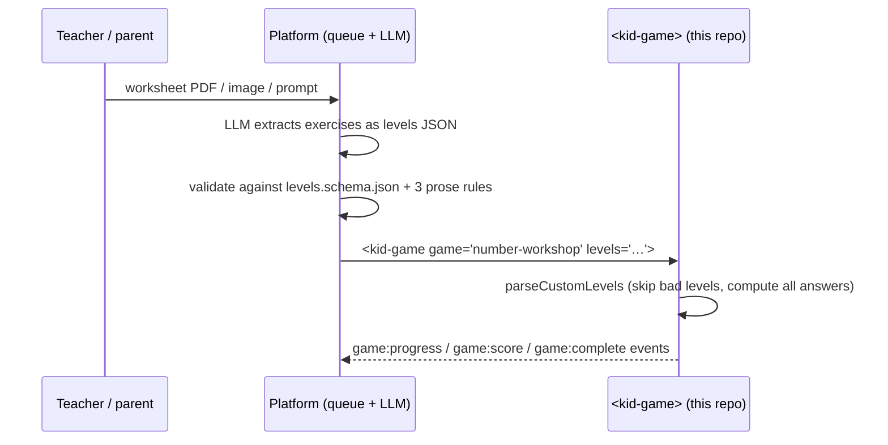

# 07 — Platform Integration (Lesson Generator → `levels`)

> Part of the [`number-workshop` plan](README.md). Status: 🗺️ Planned.
> Audience: whoever builds the external lesson-generator platform. ⚠️ We only know that platform as a general idea: a file, image, or text prompt goes to an LLM behind a queue, which returns a gamified lesson grounded in the input. Everything below is this repo's side of the contract; nothing here assumes how the platform is built.

## 1. The division of labour ("Reading A")



- The LLM **transcribes operands**. It does not solve, explain, or write game code.
- The cartridge **computes every answer** and ignores any answer the LLM includes.
- If the JSON is unusable, the game silently plays procedural levels for the given `age` and `difficulty`. The platform cannot detect that from events today, so it should validate before sending (§3).

## 2. What the LLM should output

The schema is in [02-level-schema.md](02-level-schema.md) §1–§2 and, once WP1 lands, in `games/number-workshop/levels.schema.json`.

Mapping a worksheet to modes:

| The exercise looks like | Mode | Fields |
|---|---|---|
| `27 ÷ 3 = …` with small numbers (times-table range) | `facts` | dividend 27, divisor 3 |
| `60 000 ÷ 100 = …` (divisor is 10, 100, or 1000) | `shift` | dividend 60000, divisor 100 |
| `78 = (8 × …) + …` | `euclid` | dividend 78, divisor 8 |
| "Pose et calcule" / written division, `806 ÷ 5` | `long` | dividend 806, divisor 5 |
| anything else | — | omit it; do not force it into a mode |

Guidance to put in the extraction prompt (wording is the platform's choice):

1. Output JSON only: an array of objects with `mode`, `dividend`, `divisor`.
2. Numbers are JSON integers without separators: `60000`, not `"60 000"` and not `60.000`.
3. Never include answers. Never invent exercises that are not in the source, unless the user asked for more practice.
4. Skip any exercise that does not fit a mode or its limits rather than adjusting its numbers.
5. Prefer 5–10 levels per set; split a long worksheet into one set per exercise block. The hard cap is 30.

The sample worksheet as a correct output: [05-test-plan.md](05-test-plan.md) §1.

## 3. Validating before sending

1. Validate against `levels.schema.json` with any JSON Schema (2020-12) tool.
2. Check the three rules the schema cannot express: `dividend ≥ divisor`; for `shift`, `dividend` is a multiple of `divisor`; for `facts` the quotient is at most 12 and for `euclid` at most 20.
3. If validation fails, retry the LLM or drop the offending levels. Do not "repair" numbers: a changed operand is a different exercise from the teacher's.

The platform is free to recompute answers itself for its own records; `a = b × q + r` with `0 ≤ r < b` is all there is.

## 4. Embedding

```html
<kid-game id="lesson" game="number-workshop" age="9-11" difficulty="medium" locale="fr"></kid-game>
<script type="module">
  const el = document.getElementById('lesson');
  el.levels = levelsFromTheQueue;            // property: no attribute-size or escaping concerns
  el.addEventListener('game:complete', (e) => save(e.detail)); // { stars, score, timeElapsed, summary }
</script>
```

Existing behaviour to know ✅ (see [docs/ARCHITECTURE.md](../../ARCHITECTURE.md)):

- Prefer the `levels` **property** over the attribute. Once the property is set it wins over the attribute until it is set back to `null`.
- Events bubble and cross the shadow boundary.
- Supported locales are `en` and `fr`. Anything else renders in English.
- The library is not on npm; load the built ES bundle or use a git dependency (AGENTS.md §8.4). In SSR frameworks import it client-side only (§8.6).
Planned behaviour of this cartridge 🗺️ ([03-architecture.md](03-architecture.md) §5): `game:progress` and `game:score` once per solved level, `game:complete` once at the end.

- The `game` attribute should always be a constant chosen by the platform's own code, never text taken from the LLM or from a user.

## 5. What the platform does not get (yet)

| Wish | Today | Where it is tracked |
|---|---|---|
| Per-attempt telemetry (which answers were wrong) | Only level-level events; mistakes influence `stars` | would need a core event → separate approved `src/` PR |
| A signal that custom levels were rejected | None | same |
| A catalogue of level schemas for all cartridges, so the LLM can pick the best game for a worksheet | Each cartridge documents its own shape in its README | [TODO.md](../../../TODO.md) Theme 6 |
| Arithmetic beyond division | Not built | after `number-workshop` 1.0.0 |
| Arabic UI | Not supported by the core (`en`/`fr` only) | not on the roadmap yet; needs an owner decision and core work (locale + RTL) |

## 6. Safety position

- Children never see LLM-written text in this cartridge (decision D7), only numbers that passed validation and wording shipped in the repo.
- The cartridge makes no network requests and stores nothing; what the platform does with the events is the platform's responsibility (it should not attach them to a child's identity without a lawful basis and parental consent).
