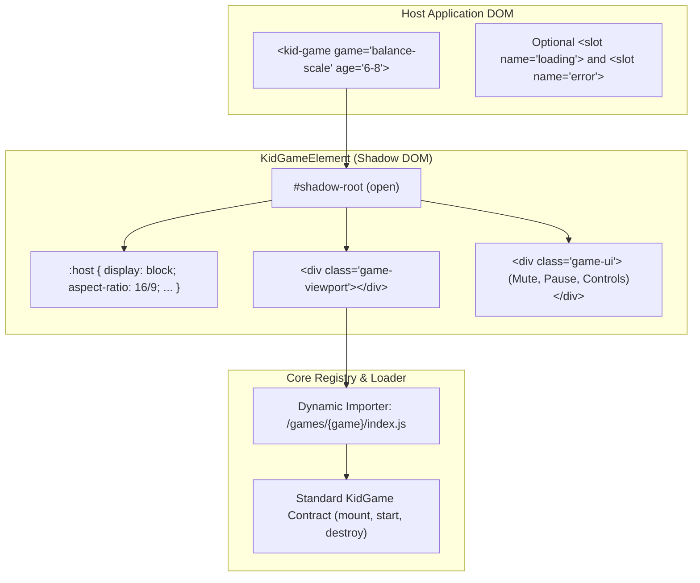

# Web Component Specification: `<kid-game>`

> **Implementation Status (2026-11-13)**: ✅ **Implemented** (with 🚧/🗺️ minor differences noted below)  
> - **Implemented (✅)**: `<kid-game>` custom element with open Shadow DOM, observed attributes (`game`, `age`, `difficulty`, `sound`, `autostart`, `locale`, plus `levels`), live attribute reactivity via `updateConfig()`, methods (`start()`, `pause()`, `resume()`, `restart()`), and `CustomEvent` dispatching (`game:ready`, `game:start`, `game:progress`, `game:score`, `game:complete`, `game:error`) with `bubbles: true, composed: true` in [KidGameElement.ts](../../src/core/KidGameElement.ts).  
> - **Partial / Planned (🚧 / 🗺️)**: Named Shadow DOM fallback slots (`<slot name="loading">` and `<slot name="error">`) and a shared host `<div class="game-ui">` overlay are 🗺️ **Planned** (currently `<kid-game>` uses an internal `.status-screen` overlay and each cartridge renders its own HUD inside `.game-slot`). Also, `difficulty` is parsed and passed in `context.difficulty` (🚧 **Partial**), while current cartridges scale puzzles by `ageGroup`.

> **Status**: Approved Direction (Method A)  
> **Role**: Universal, framework-agnostic HTML Custom Element embedding any kid lesson game.

---

## 1. Overview & Vision

The `<kid-game>` custom element allows any modern web app (React, Vue, Svelte, Angular, plain HTML, WordPress) to embed an educational game with a single HTML tag:

```html
<kid-game 
  game="balance-scale" 
  age="6-8" 
  difficulty="medium" 
  sound="true">
</kid-game>
```

---

## 2. Component Architecture



---

## 3. HTML Attributes & Observed Properties

| Attribute | Type | Default | Description |
| :--- | :--- | :--- | :--- |
| `game` | `string` | *(required)* | Identifier of the game (e.g., `balance-scale`) |
| `age` | `string` | `"6-8"` | Age bracket: `"3-5"`, `"6-8"`, or `"9-11"` |
| `difficulty` | `string` | `"medium"` | `"easy"`, `"medium"`, `"hard"` |
| `sound` | `boolean` | `true` | Audio SFX enabled/disabled |
| `autostart` | `boolean` | `true` | Start gameplay immediately upon load |
| `locale` | `string` | `"en"` | Language code for prompts and text |

> **Reactivity**: Changing an observed attribute (e.g., `el.setAttribute('sound', 'false')`) immediately updates the running game instance without unmounting it.

---

## 4. Custom Events Protocol

The component bubbles standard `CustomEvent` instances so the host application can track learning progress and reward systems:

```mermaid
sequenceDiagram
    autonumber
    participant Host as Host Page
    participant Element as &lt;kid-game&gt;
    participant Logic as Game Module

    Host->>Element: Element connected to DOM
    Element->>Logic: import('/games/balance-scale') & mount()
    Logic-->>Element: Ready
    Element-->>Host: Dispatches 'game:ready'

    Note over Host,Element: Autostart or el.start()
    Element->>Logic: start()
    Element-->>Host: Dispatches 'game:start'

    Note over Logic: Child solves a sub-problem
    Logic-->>Element: onProgress(step 1 of 3)
    Element-->>Host: Dispatches 'game:progress' { detail: { step: 1, total: 3 } }

    Logic-->>Element: onScore(points: 50, streak: 2)
    Element-->>Host: Dispatches 'game:score' { detail: { points: 50, streak: 2 } }

    Note over Logic: Child balances all weights!
    Logic-->>Element: onComplete(stars: 3)
    Element-->>Host: Dispatches 'game:complete' { detail: { stars: 3, timeElapsed: 28 } }

    Host->>Element: Element removed from DOM
    Element->>Logic: destroy() (Clean physics & listeners)
```

### Event Details Reference

- **`game:ready`**: Assets loaded; ready for player interaction.
- **`game:start`**: Play round has begun.
- **`game:progress`**: `event.detail = { step: number, total: number }`
- **`game:score`**: `event.detail = { points: number, streak: number }`
- **`game:complete`**: `event.detail = { stars: 1 | 2 | 3, score: number, timeElapsed: number }`
- **`game:error`**: `event.detail = { message: string, code: string }`

---

## 5. JavaScript DOM API

For developers interacting programmatically via script:

```javascript
const el = document.querySelector('kid-game');

// Methods
el.start();
el.pause();
el.resume();
el.restart();

// Listeners
el.addEventListener('game:complete', (e) => {
  const { stars, score } = e.detail;
  showRewardModal({ stars, score });
});
```

---

## 6. Shadow DOM & Container Styling

By default, `<kid-game>` provides responsive container ergonomics:
- Default aspect ratio: `16 / 9` or auto-stretching to fill parent container (`width: 100%; height: 100%`).
- Shadow DOM prevents host page CSS (like Tailwind or global resets) from distorting game canvas or SVG elements.
- Accessible fallbacks via `<slot name="loading">` and `<slot name="error">`.
